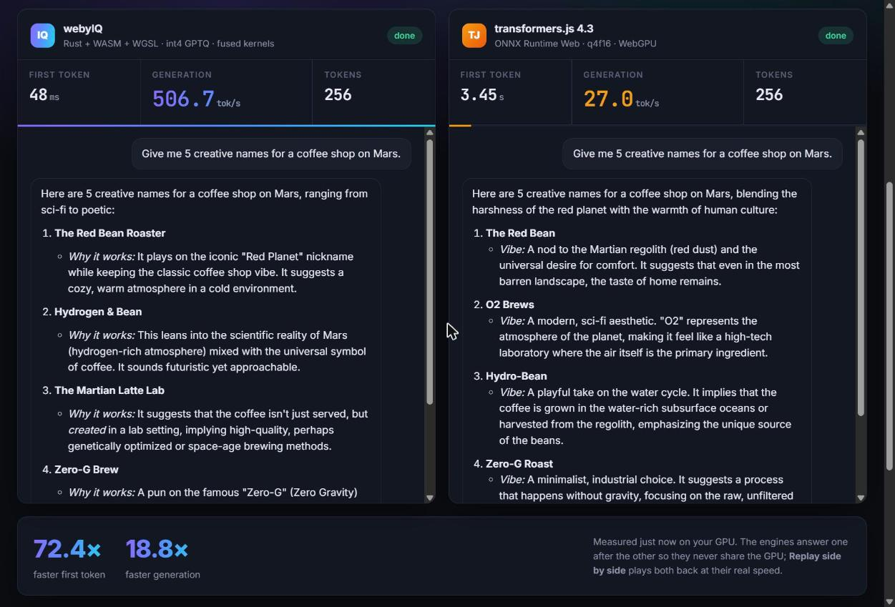
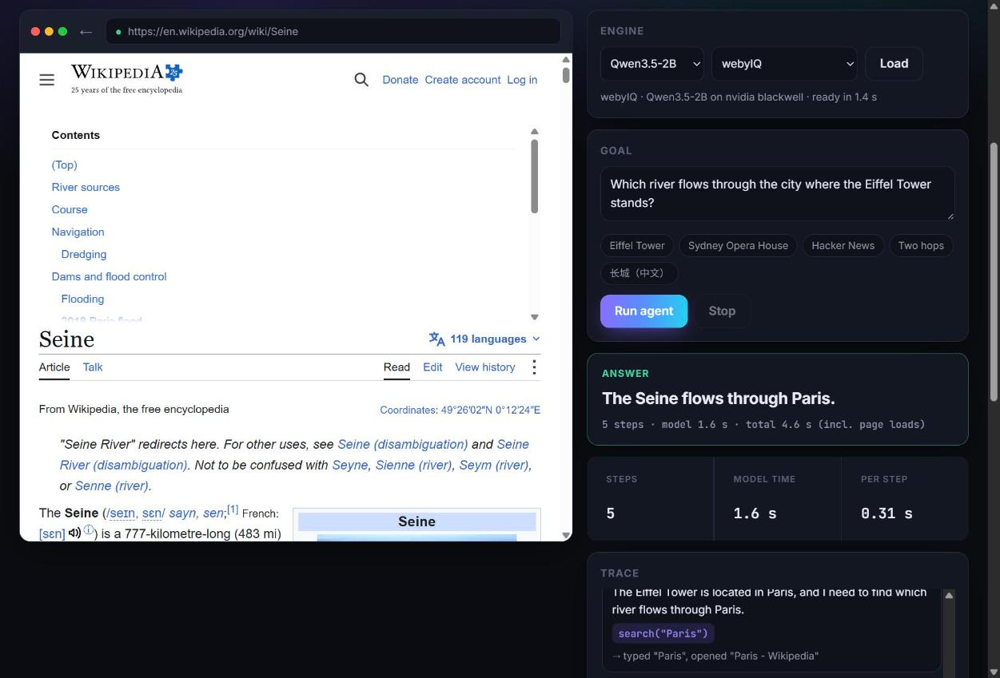

# webyIQ

**Model-specialized LLM inference for the browser, on WebGPU.** A Rust engine with hand-written WGSL
kernels for a few of the best small (≤ 2B) models, instead of a generic graph runtime: fused int4 × int8
kernels, a GPU-resident decode loop, speculative decoding with the model's own MTP head, GPTQ-quantized
weights. The same engine runs natively (wgpu on Vulkan / DX12) for development and in the browser as a
~390 KB wasm module.

**[Online demo](https://rtx527896828.github.io/webyIQ/)** (Chrome / Edge with WebGPU; the model, about 1.1 GB,
downloads once from the Hugging Face Hub and runs on your GPU).

Same model (Qwen3.5-2B), same prompts, Chrome 156, greedy:

| | webyIQ | WebLLM 0.2.87 (MLC q4f16_1) | transformers.js 4.3 (ONNX q4f16) |
|---|---|---|---|
| RTX 5080, generation | **620 tok/s** (MTP speculative), 417 plain | 94 tok/s | 31 tok/s |
| RTX 5080, ~1,050-token prompt | **0.20 s** (5,200 tok/s) | 0.81 s (1,310 tok/s) | 128.7 s (1,024 tokens) |
| RTX 5080, first token of a chat reply | **14 ms** | 46 ms | 16.3 s (128 tokens) |
| AMD Radeon iGPU (2 CUs), generation | **37 tok/s** | 4.7 tok/s | device lost |
| AMD iGPU, ~1,050-token prompt | **9.1 s** | 66 s | – |
| Load from cache (5080) | 1.9 s | 7.6 s | |

Weights: int4 GPTQ, WikiText-2 perplexity +2.4% over bf16. Speculative decoding verifies every draft
token, so the output is the same as plain greedy decoding.



Supported models: **Qwen3.5-2B** (Gated DeltaNet + gated attention, MTP head) and **MiniCPM5-2B**
(Llama architecture). Each one is a graph built from a few specialized kernels, see [Kernels](#kernels).

What you can try:

- **Chat arena** (`web/chat.html`): ask webyIQ and transformers.js the same question, see time to first
  token and tokens/s live, replay both answers side by side at their real speed.
- **Browser agent** (`web/agent.html`): a local 2B model operates a real web page through the DOM
  (search, click, type, read) to reach a goal, ~0.2–0.4 s per step on a discrete GPU.
- **Browser extension** (`extension/`): the same agent in a Chrome / Edge side panel, on any page you
  open.



Converted weights: [tixiren/Qwen3.5-2B-webyIQ](https://huggingface.co/tixiren/Qwen3.5-2B-webyIQ),
[tixiren/MiniCPM5-2B-webyIQ](https://huggingface.co/tixiren/MiniCPM5-2B-webyIQ) (Apache-2.0, as the
original models). The extension and the online demo load them from there.

Status: a research prototype, tested on Windows with Chrome / Edge 156 (RTX 5080 and an AMD Radeon
iGPU). Safari and mobile are untested.

## Quick start

To run the demo pages locally with the hosted weights, only the wasm build is needed (step 2; open the
pages with `?hub`). To convert the models yourself:

Requirements: Rust (stable) with `wasm32-unknown-unknown` and [wasm-pack](https://rustwasm.github.io/wasm-pack/),
Node.js 18+, [uv](https://docs.astral.sh/uv/) (Python tools, CPU PyTorch), a browser with WebGPU.

```sh
# 1. weights: download, quantize (RTN takes minutes; GPTQ ~16 min on CPU, better quality), convert
cd tools
uv run hf download Qwen/Qwen3.5-2B --local-dir ../models/hf/Qwen3.5-2B
uv run python gptq.py ../models/hf/Qwen3.5-2B ../models/gptq-qwen3.5-2b
uv run python convert.py ../models/hf/Qwen3.5-2B ../models/qwen3.5-2b-gptq --prequant ../models/gptq-qwen3.5-2b --search
#    (optional: the reduced draft vocabulary for faster speculative decoding, see "Run" below)
cd ..

# 2. engine for the browser, then the pages
wasm-pack build crates/web --target web --release --out-dir ../../web/pkg
node tools/serve.mjs
# open http://127.0.0.1:8765/web/chat.html (or agent.html; index.html, compare.html: benchmarks)

# 3. optional: the extension
node tools/build-extension.mjs   # then chrome://extensions -> Developer mode -> Load unpacked -> extension/
```

MiniCPM5-2B: the same steps with `openbmb/MiniCPM5-2B` and `../models/minicpm5-2b-gptq`. The
transformers.js side of the chat arena reads ONNX models from `models/onnx/` (`Qwen3.5-2B-ONNX` from
`onnx-community`, MiniCPM5 exported with `tools/onnx-export`).

## Layout

| Path | What |
|---|---|
| `crates/engine` | Engine: manifest, static buffer/bind-group setup, decode step, pipelined readback, profiling |
| `crates/engine/src/shaders` | WGSL kernels (see below) |
| `crates/cli` | Native runner: `--ref` correctness check vs torch, `--bench`, `--profile` (GPU timestamps), `--ppl`, `--spec` (speculative vs plain) |
| `crates/web` | wasm-bindgen wrapper (`WebEngine`) |
| `web/index.html` | Browser bench + chat page; `web/tjs.html` transformers.js baseline, same protocol; `web/compare.html` webyIQ vs WebLLM on chat prompts |
| `tools/convert.py` | HF safetensors -> webyIQ int4 format (`manifest.json` + <=128 MB shards) |
| `tools/reference.py` | torch reference logits, optional identical int4 fake-quant |
| `tools/onnx-export` | ONNX q4f16 export of the same model for the transformers.js baseline |
| `tools/gptq.py` | GPTQ into the same int4 format |
| `tools/mtp_ref.py` | torch reference of the Qwen3.5 MTP head (draft acceptance, conventions) |
| `tools/draft_vocab.py` | token-frequency ranking for the reduced draft lm_head |
| `tools/prompt_ids.py` | tokenized chat prompts for the native runner |

## Demo pages

Served by `node tools/serve.mjs` (open http://127.0.0.1:8765/web/chat.html):

- `web/chat.html`, **Chat arena**: the same question to webyIQ and transformers.js (same model,
  tokenizer and chat template, greedy), one after the other so they never share the GPU, with live
  first-token latency and tok/s; *Replay side by side* plays both answers back at the speed they
  were produced. Qwen3.5-2B or MiniCPM5-2B.
- `web/agent.html`, **Browser agent**: a goal, a real web page in a frame, and the local model
  driving it through the DOM: numbered links / inputs / buttons and a window of the page text go
  into the prompt, the model replies `Thought:` + one action (`search`, `click`, `type`, `find`,
  `scroll`, `back`, `answer`), the page script performs it. Pages come through the dev server's
  `/proxy` (allowlist: en/zh/simple Wikipedia, Hacker News; GET only, scripts removed) because a
  cross-origin frame's DOM is off limits.
- `web/lib/`: shared loaders (`webyiq.js`, `tjs.js`), chat tokenizer (`tokenizer.js`, vendored
  `@huggingface/tokenizers` + `@huggingface/jinja`, token-identical to HF on the test prompts),
  agent (`agent-core.js`: prompt, parsing, loop; `dom-agent.js`: page snapshot and actions, through
  open shadow roots), model list, styles. `?autotest` on either page runs a scripted session and
  posts the result to `/report`.

## Browser extension (`extension/`)

The agent on any page: a side panel (Chrome / Edge, Manifest V3) runs the model on WebGPU and drives
the active tab through `chrome.scripting` (no proxy; the site's own scripts run normally).

```sh
wasm-pack build crates/web --target web --release --out-dir ../../web/pkg
node tools/build-extension.mjs     # copies web/lib, web/vendor, web/pkg into extension/, draws icons
# chrome://extensions -> Developer mode -> Load unpacked -> extension/
node tools/serve.mjs               # model source "local server"; or pick a model folder on disk
```

Weights come from a URL (the dev server by default; cached in the Cache API) or from a model folder
picked with the File System Access API. Permissions: `sidePanel`, `scripting`, `storage`, host access to
all sites (to read and operate the pages it is asked to work on). Test runs:
`tools/gpu-bench.ps1 -Browser Edge -Extension extension -Url "ext-autotest?autotest&tab=<url>&goal=<text>"`
(branded Chrome no longer accepts `--load-extension`; Edge does, run with `--disable-sync`).

Measured with Qwen3.5-2B on an RTX 5080 (Edge, live sites, greedy): Wikipedia "When was the Eiffel
Tower completed?" 2 steps / 0.6 s model time; Chinese Wikipedia 长城长度 2 steps; Python docs "what
does zip() return" 3 steps; Bing "population of Tokyo" 4 steps; Hacker News top story 1 step.
Failures: MDN (the search jumps straight to the first hit and the model does not notice it already has
the answer), "open the top story's comments" on HN (picks the site-wide "comments" link). Each step
costs 0.2-0.5 s of model time; page loads dominate the total.

## Kernels

Decode (per layer, 10 dispatches): `norm_quant` (RMSNorm + int8 activation quant) -> `qkv` (int4 x int8
GEMV, `dot4I8Packed`, subgroup reduction) -> `rope_kv` -> `attn` (flash-decoding, chunks of 32 positions)
-> `attn_combine` (+ int8 quant) -> `o` (+ residual) -> `norm_quant` -> `gate_up` (+ SwiGLU) -> `quant` ->
`down` (+ residual). Argmax stays on the GPU, so decode steps are queued ahead and read back through a
ring of staging buffers.

Prefill (chunks of 128 tokens): same structure with a tiled int4 x int8 GEMM (32 tokens x 32 rows per
workgroup) and a causal online-softmax attention; only the last token goes through lm_head.

Qwen3.5 linear-attention layers: `in_proj` (fused qkv|z|b|a GEMV/GEMM) -> `deltanet` (one workgroup per
head, 128x128 state column kept in registers: causal conv1d + SiLU, L2-norm, decay/beta gates, delta-rule
update, gated RMSNorm; loops over the tokens of a prefill chunk) -> `quant` -> `o`. Full-attention layers
use `qk_norm_rope` (per-head RMSNorm + partial rotary) and a sigmoid output gate fused into
`attn_combine` / `attn_prefill`. The graph (`graph.rs`) is built per architecture from one op list.

Speculative decoding (Qwen3.5, MTP head): each step runs the main model on [last token, draft]
(GEMV over both tokens at once, `T = 2`), lm_head + argmax of both, then the MTP layer
(`mtp_in`: cat(norm(embedding of the greedy token), norm(final-normed hidden)) -> `fc` -> one gated
full-attention layer with its own KV cache) and its draft lm_head, and `spec_accept`. Everything stays
on the GPU: `spec_accept` writes the next step's tokens and Params (copied into the uniform buffer)
and a 20-byte readback (1 or 2 tokens), so steps are pipelined like plain decoding. DeltaNet state
has 3 slots; a step keeps the state after each of its two tokens, so a rejected draft costs nothing
to roll back. Attention dispatches use an upper bound of the position and skip unused chunks.
The draft lm_head covers the 32768 most frequent tokens (EN prose, Chinese, code; `draft_vocab.py`),
gathered from the embedding on the GPU at load (only the 128 KB id list ships). Every draft token
is verified against the full vocabulary, so the output is identical to plain greedy decoding.

Weights: asymmetric int4, group 32, f16 scale/min (5 bits/weight, 1.47 GiB total).
Shader variants: `ShaderCaps` selects subgroup reductions and a polyfill for browsers without
`packed_4x8_integer_dot_product` (`//#if SUBGROUPS` blocks, see `shader_source`).
`vendor/wgpu` is wgpu 30.0.1 with `subgroups` added to the WebGPU feature mapping (missing upstream).

## Run

```sh
# convert (needs uv): plain RTN, or GPTQ (same runtime format, better codes; ~25 min on CPU)
cd tools && uv run python convert.py ../models/hf/MiniCPM5-2B ../models/minicpm5-2b-q4g32
uv run python gptq.py ../models/hf/MiniCPM5-2B ../models/gptq-minicpm5-2b
uv run python convert.py ../models/hf/MiniCPM5-2B ../models/minicpm5-2b-gptq --prequant ../models/gptq-minicpm5-2b --search
# Qwen3.5-2B: same commands with ../models/hf/Qwen3.5-2B (GPTQ ~16 min); for the draft lm_head
curl -L -o ../models/corpus/zhwiki-00002.parquet     https://huggingface.co/datasets/wikimedia/wikipedia/resolve/main/20231101.zh/train-00002-of-00006.parquet
uv run python draft_vocab.py ../models/hf/Qwen3.5-2B ../models/corpus/zhwiki-00002.parquet ../models/eval/q35_draft_vocab.json
uv run python convert.py ../models/hf/Qwen3.5-2B ../models/qwen3.5-2b-gptq --prequant ../models/gptq-qwen3.5-2b --search \
    --draft-vocab ../models/eval/q35_draft_vocab.json
uv run python prompt_ids.py ../models/hf/Qwen3.5-2B ../models/eval/q35_chat_prompts.json
uv run python reference.py ../models/hf/MiniCPM5-2B ../models/ref/fq_capital --fakequant

# native
cargo build --release -p webyiq-cli
./target/release/webyiq-cli models/minicpm5-2b-q4g32 --adapter 5080 --backend vulkan \
    --ref models/ref/fq_capital --bench 128 --profile --ppl models/eval/wiki2_8x512.json
./target/release/webyiq-cli models/qwen3.5-2b-gptq --adapter 5080 --backend vulkan \
    --spec models/eval/q35_chat_prompts.json 200    # plain vs speculative: identical output, speed

# browser
wasm-pack build crates/web --target web --release --out-dir ../../web/pkg
node tools/serve.mjs                             # static files + /report
# open http://127.0.0.1:8765/web/index.html  and  /web/tjs.html
```

## Results (2026-11-02, Chrome 156, greedy, 128 decoded tokens)

Same protocol on both sides (`web/index.html?autobench`, `web/tjs.html?autobench`).

| | webyIQ | transformers.js 4.3.1 (q4f16) |
|---|---|---|
| RTX 5080 decode | **~278 tok/s** | 89.8 tok/s |
| RTX 5080 TTFT, 128 / 1024 prompt tokens | **31 ms / 310 ms** | 361 ms / 544 ms |
| AMD Radeon iGPU (2 CU RDNA2) decode | **33.0 tok/s** | 4.7 tok/s |
| AMD iGPU TTFT, 128 / 1024 | **1.39 s / 12.9 s** | 2.39 s / 16.3 s |
| Weights | 1.47 GiB (int4 incl. embedding) | 1.83 GB (fp16 embedding) |
| Load, warm (5080) | 1.5 s (Cache API) | 2.6 s |
| Runtime download | ~300 KB wasm | ORT Web + transformers.js |

Quality (8 x 512 tokens each, `tools/ppl.py` / `webyiq-cli --ppl`; GPTQ calibrated on WikiText-2 *train*):

| | WikiText-2 test | C4 validation |
|---|---|---|
| bf16 (torch) | 21.23 | 25.76 |
| int4 RTN weights + int8 activations (torch fake-quant) | 23.66 | |
| webyIQ engine, RTN | 23.65 (+11.4%) | 28.48 (+10.6%) |
| webyIQ engine, RTN + clip search | 23.39 (+10.2%) | |
| **webyIQ engine, GPTQ** (same format/size) | **21.83 (+2.8%)** | **26.70 (+3.6%)** |

The engine matches its torch fake-quant reference (implementation check); GPTQ removes most of the
int4 loss without any runtime change. KV cache is f16 (176 MB at 4096 context); f16 KV had no
measurable PPL effect.

iGPU testing: Chrome on Windows binds the whole browser to one GPU;
`tools/gpu-bench.ps1 -Gpu AMD -Url "web/index.html?autobench"` runs a page in a throwaway Chrome
pinned via `--use-adapter-luid` and collects the result through `tools/serve.mjs` (`POST /report`,
`models/reports.jsonl`; `python tools/show_report.py` prints it).

### Qwen3.5-2B

| | webyIQ | transformers.js 4.3.1 (onnx-community/Qwen3.5-2B-ONNX, q4f16) |
|---|---|---|
| RTX 5080 decode | **~418 tok/s** | 31 tok/s |
| RTX 5080 TTFT, 128 / 1024 | **25 ms / 198 ms** | 16.3 s / 128.7 s |
| AMD iGPU decode | **37 tok/s** | device lost (crash) |
| AMD iGPU TTFT, 128 / 1024 | **1.08 s / 8.9 s** | - |
| Weights | 1.10 GiB | |

Native (Vulkan, 5080): 446 tok/s pipelined decode, 128-token prefill 16.4 ms.

Speculative decoding with the MTP head (chat bench: 4 chat prompts, EN / ZH / code / table, up to
200 greedy tokens each; plain and speculative outputs identical on every GPU):

| | plain | speculative | tokens / step |
|---|---|---|---|
| RTX 5080, Chrome | 389 tok/s | **581 tok/s (1.49x)** | 1.69 |
| RTX 5080, native Vulkan | 402 tok/s | **629 tok/s (1.56x)** | 1.68 |
| AMD iGPU, Chrome | 37.0 tok/s | 37.7 tok/s (1.02x) | 1.68 |

(5080 numbers measured while other applications were using the GPU; plain and speculative ran back
to back.) The iGPU's GEMV is partly ALU-bound, so a second token per weight load is not free (a
spec step costs 1.6x a plain step). `web/index.html` times both kinds of step at load and enables
speculative decoding only where it pays off (predicted 1.47x / 1.03x above). Draft acceptance in
torch (bf16, same prompts): 74.5% with the full vocabulary, 70.5% with the 32K draft vocabulary.

| PPL (8 x 512) | WikiText-2 test | C4 validation |
|---|---|---|
| bf16 (torch) | 17.14 | 20.74 |
| int4 RTN + int8 act (torch fake-quant) | 17.99 | 22.36 |
| webyIQ engine, RTN | 17.97 (+4.8%) | 22.40 (+8.0%) |
| **webyIQ engine, GPTQ** | **17.56 (+2.4%)** | **21.48 (+3.6%)** |

The tied embedding/lm_head stays RTN + clip search (GPTQ for lm_head would hurt the lookup). Decode,
sequential prefill and batched prefill agree on sampled positions.

## Known issues / next

- Speculative decoding: one draft token per step. Chaining the MTP layer for 2-3 drafts, or a
  tree of drafts, would raise tokens/step on fast GPUs. The recurrent state still cannot be rolled
  back past what a step keeps, so `discard_ahead` after unconsumed steps needs a reset.

- iGPU prefill is ALU-bound (~180 GMAC/s on 2 CUs); GEMM still has headroom on all GPUs.
- naga's HLSL for `dot4I8Packed` crashes DXC (ICE); native DX12 uses FXC (slow int8 path). Use
  `--backend vulkan` natively; Chrome (Tint) is fine.
- Safari / iOS: untested; the packed-int8 polyfill path exists (`?nodp4a` to force it).
- Next: a smaller weight format (4.5 bpw super-block scales) for phones; iOS / Safari testing;
  speculative decoding for integrated GPUs (cheaper verification).
- Browser weight cache: shards are keyed by URL + content hash (`shard_hashes` in the manifest).

## License

Apache-2.0 (see `LICENSE`). Vendored code keeps its own license: `vendor/wgpu` (MIT / Apache-2.0,
wgpu 30.0.1 with a small patch), `web/vendor` (`@huggingface/tokenizers`, `@huggingface/jinja`,
Apache-2.0). Model weights are not part of this repository; Qwen3.5 and MiniCPM5 are under their
authors' licenses.
